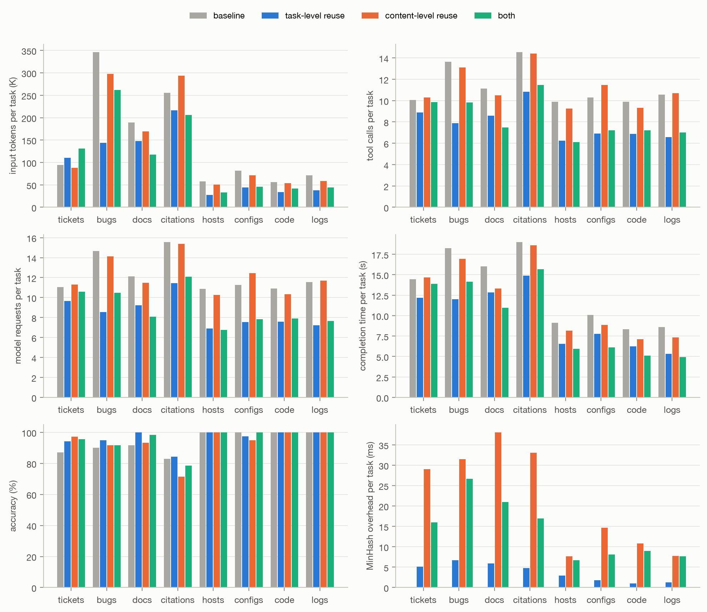

Code: <https://github.com/haotianxia/a2-minhash>. The three required files are `minhash.py`, `policy.py` and `content.py`; `kickoff.py` runs the experiments and `plotty.py` draws the figures.

# 1. Methodology and Implementation

The three files share one representation. A text is lower-cased and split into alphanumeric tokens, and every three consecutive tokens form a shingle. `MinHash` in `minhash.py` hashes each shingle once with 8-byte BLAKE2b, reduces it modulo `p = 2^31 - 1` and applies 128 functions `h_i(x) = (a_i x + b_i) mod p`, with `a_i` and `b_i` drawn from `numpy.random.default_rng(1115)`. A signature stores the minimum of each function over the set, and the fraction of equal positions in two signatures estimates their Jaccard similarity. `LSH(bands, rows)` splits a signature into bands and files the item under each band's bytes; a query returns every item that shares at least one bucket, which happens with probability `1 - (1 - J^r)^b`. On 13,785 pairs of history records (every pair among the first 90 records of tickets, bugs and docs and the 60 of hosts; 98% of them below J = 0.2 and 19 above 0.6) the estimate has a mean error below 0.01 in every 0.2-wide bin and a standard deviation within 0.004 of the theoretical `sqrt(J(1-J)/128)`, and on synthetic set pairs (120 pairs of 400-element sets per similarity level) the measured LSH candidate rates follow the theoretical curves (Figure 1). Measured on their own, a task signature takes about 0.1 ms, a lookup 0.1 to 0.25 ms, and indexing the 140 history records of tickets (83 KB) 17 ms. Inside the experiment, where the streams run as threads of one Python process, lookups took 0.4 ms (median) and the index builds of the record datasets 200 to 275 ms; the MinHash overhead in Table 1 is built from these in-run times.

{width=100%}

**Task-level reuse (`policy.py`).** `TaskReuse(dataset_dir)` indexes every record of `env/history.jsonl`. It recognises the dataset from the fields of these records (`resolution_id` for tickets, `root_cause` for bugs, `category` for docs, `verdict` for citations and `scenario` for the six corpus datasets), so a held-out copy gets the right key and answer fields under any folder name. For each incoming task, in `seq` order, `lookup(task)`:

1. builds the task text from every field except ids and dates (for tickets: product, error code, platform, subject and body) and queries an LSH index with 64 bands of 2 rows, which returns a record at Jaccard 0.3 with probability 0.998;
2. keeps the candidates whose estimated similarity is at least `tau` and whose validation key equals the task's key (table below);
3. reuses an answer only when all kept candidates carry the same answer under `norm_answer_value`, the corpus verifiers' normalisation applied to every field except `duplicate_of`, and takes it from the most similar one. For tickets and bugs this is stricter than the verifiers (`R-7` and `R-07` count as different), and on the stored answers of all four record datasets it never merges two values of the compared fields that a verifier tells apart, so it can only make the policy more cautious. On docs, reusing a history record sets `duplicate_of` to that record's id, and reusing an earlier task copies its verified answer.

| dataset | validation key (the rule published in each dataset's `INSTRUCTIONS.md` and `README.md`) |
|---|---|
| tickets | product, error code (`E-1042` = `e1042`), platform |
| bugs | exception class without module, top frame (`a.b.c` or `a/b.py::c`, no line number), version series `major.minor` |
| docs | identifier (`CHG`, `INC`, `POL`, `REL`) and status class (the first class, in the order approved, rejected, request, resolved, open, final, draft, whose stem occurs in the title or body) |
| citations | DOI, title tokens, (surname, initial) of each author in order, venue mapped through the aliases in `db.json`, year |
| the six corpus datasets | scenario, kind, target |

The threshold `tau` starts at 0.3 and is raised by the data. Each time a verified record enters the index it is compared with the indexed records that have the same key; if one of them has a different answer, `tau` becomes `max(tau, similarity + 0.1)`. The margin of 0.1 is slightly more than two standard deviations of the estimate at J = 0.5. History alone sets `tau` to 0.725 on tickets, where two records with the same key and different resolutions reach 0.625, and to 0.389 on bugs; on the other six datasets no two records with the same key disagree and `tau` stays at 0.3. No task of the experiment moved it further. When the agent's answer to a task passes `verify.py`, `add(tid, task, answer)` indexes the task, so later duplicates of incoming tasks are found as well; a reused answer is indexed the same way once it passes. The policy reads only `env/` and the verifier's pass or fail.

**Content-level reuse (`content.py`).** `ContentReuse().tools(workdir)` returns `read_file`, `grep`, `list_files` and `bash` with their original schemas. Passed to `Harness` as `extra_tools`, they replace the built-in tools of the same name, so the harness code stays unchanged. Every output goes through `fold`:

1. Outputs under 400 characters pass unchanged. Line numbers of `read_file` are removed for the comparison. Any other output is split into parts, a new part starting at each line of at most 160 characters that names a file of the scenario directory, so a loop that prints `== config/dev.yaml` before each file gives one part per file. If no part reaches 400 characters, as in a grep hit list where every line names a file, the whole output is compared as one part.
2. A part identical to an earlier one becomes a single line, `[reuse] identical to read_file(path=...) shown earlier (95 lines).`, which names the earlier output by its tool and the first 100 characters of its arguments.
3. Otherwise the part's signature is computed with every digit run and hexadecimal id replaced by `0`, and an LSH index with 32 bands of 4 rows over the earlier parts returns candidates. For the three most similar candidates with similarity of at least 0.5 the layer writes an exact line diff (unified format, no context lines) against the earlier, unmasked text and keeps the shortest.
4. The diff replaces the part only if it is at most 75% as long as the part. Otherwise the part is returned unchanged and becomes a reference for later parts.

Masking only decides which earlier part to compare against. The diff is computed on the exact text, so every number, identifier or configuration line that differs appears in the folded output, and every line not listed equals a line the model has already read in the same trajectory. Only parts returned in full become references, so no fold depends on another fold. The `INSTRUCTIONS.md` of the four corpus datasets already tells the agent, in every configuration, that a repeated file may come back as a reference marked `[reuse]` plus the lines that differ; the record datasets give no such hint. I replayed through the layer all 851 scenario files of hosts, configs, code and logs one by one, the same 96 scenarios printed by one batched `bash` loop each (which the harness cuts to 12,000 characters), and the 420 baseline transcripts. This produced 829 folds, 755 diffs and 74 identical repeats, and expanding each fold from its reference reproduced the original part in all 829 cases.

# 2. Experiments

I use eight datasets, the record datasets tickets, bugs, docs and citations and the corpus datasets hosts, configs, code and logs, and run all 420 of their incoming tasks: 70 each for tickets and citations, 60 each for bugs and docs and 40 for each corpus dataset. According to the published manifests, 168 of these tasks (40%) duplicate a history record or an earlier task (as exact copies, reformatted, reordered, edited or paraphrased) and 83 (20%) are hard negatives.

All four configurations run the same 420 tasks with `gemini-3.5-flash-lite` through the unmodified Spartacus harness (commit `711db62`). The harness fixes the temperature at 0.4, and I keep its defaults of 120 turns and enabled sub-agents. A sub-agent would bypass the content layer, but no run spawned one. Each task runs in a fresh working directory with `INSTRUCTIONS.md`, `history.jsonl` and `task.json`, plus `db.json` for citations and, for corpus tasks, the files of the scenario the task refers to. Every task gets the same prompt: "Solve the request in task.json: follow INSTRUCTIONS.md and write answer.json in this directory." A task is correct when the dataset's `verify.py` passes on the written `answer.json`. Within a (configuration, dataset) stream the tasks run in `seq` order, so task-level reuse can use answers verified earlier in the same stream; 16 streams run in parallel. The rows come from three sessions over two days. The first produced 696 agent runs. The second reran content-level and combined reuse on the first 30 tasks of each corpus dataset with 8 streams (197 agent runs) after I changed how `content.py` treats grep hit lists, a change that cannot affect the record datasets. The third produced the remaining 507, all on tasks after the 30th. A few runs of the first session stalled at up to 4.4 s per request, so on these 120 corpus tasks a request took 0.75 s and 0.80 s on average for the baseline and task-level runs against 0.66 s for the content-level and combined runs of the second session, while the median was 0.61 to 0.64 s in all four; part of the time that content-level and combined reuse save on the corpus datasets therefore comes from the session.

Tool calls, model requests and input and output tokens are counted from the harness events. Completion time is the lookup time plus the duration of the agent run (its last attempt, for the three baseline tasks that were retried), summed over tasks, plus the time spent building the index and indexing verified answers. It therefore includes all MinHash work, which I also report on its own as overhead. A reused task costs no tool calls, requests or tokens.

With temperature 0.4 one task can use 134 times as many input tokens in one run as in another. Bugs T-27591a took 121 requests and 5.3M input tokens in the baseline, where the agent stopped at the 120-turn limit and failed, and 10 requests and 40K tokens in the combined configuration, where neither layer acted. Tickets T-1cb53c took 9 requests and about 115K input tokens in three configurations and 121 requests and 4.0M tokens in the combined one, again with no reuse and no folded output. Seventeen of the 1,400 agent runs used more than 1M tokens and together account for 18% of all agent tokens. I therefore compare each reused task with the baseline's cost on that same task, and I measure the content layer a second time by replaying the 420 baseline transcripts through it, which removes the sampling noise.

# 3. Results

Table 1. All 420 tasks. Time is the sum of per-task completion times; percentages are relative to the baseline. Output tokens are 0.15M to 0.22M per configuration and are left out.

| configuration | accuracy | reused (wrong) | tool calls | requests | input tokens | time | MinHash overhead per task |
|-------------|----------------|-------|-------------|-------------|-------------|----------------|----------|
| baseline | 388/420 (92.4%) | | 4,831 | 5,251 | 67.3M | 97.4 min | |
| task-level reuse | 401/420 (95.5%) | 140 (0) | 3,432 (-29%) | 3,712 (-29%) | 46.1M (-32%) | 73.6 min (-24%) | 4.1 ms |
| content-level reuse | 387/420 (92.1%) | | 4,774 (-1%) | 5,191 (-1%) | 64.1M (-5%) | 90.1 min (-7%) | 24.2 ms |
| both | 396/420 (94.3%) | 140 (0) | 3,632 (-25%) | 3,910 (-26%) | 53.0M (-21%) | 74.3 min (-24%) | 15.3 ms |

Task-level reuse skips 140 agent runs, which cost the baseline 30% of its tool calls and requests, 29% of its input tokens and 27% of its time; with the variation in the other 280 runs (Table 3) the configuration used 29% fewer tool calls and requests, 32% fewer input tokens and 24% less time. Accuracy rises from 92.4% to 95.5%, and none of the 140 reused answers failed the verifier. The content-level configuration used 1% fewer tool calls and requests, 5% fewer input tokens and 7% less time than the baseline, all within the run-to-run variation (paired bootstrap 95% intervals over the 420 tasks include zero for every metric); the replay below puts the layer's own token saving at 1.7%. Combining both saves about as much time as task-level reuse alone (24%, helped on the corpus datasets by the faster second session), about four points less of the tool calls and requests and about ten points less of the input tokens. Three runaway runs of the combined configuration in which the content layer folded nothing (bugs T-704c01, tickets T-1cb53c and citations T-24c0bd) used 11.0M more tokens than the same tasks with task-level reuse alone, more than the whole gap of 6.9M (question 5).

Table 2. Per dataset: 70 tasks for tickets and citations, 60 for bugs and docs, 40 for each corpus dataset. Cells list baseline / task-level / content-level / both; the reused column lists task-level / both.

| dataset | correct | reused | input tokens per task (K) | tool calls per task | time per task (s) |
|---------|------------------|--------|---------------------------|---------------------------|---------------------------|
| tickets | 61 / 66 / 68 / 67 | 18 / 18 | 95 / 110 / 88 / 131 | 10.0 / 8.9 / 10.3 / 9.9 | 14.4 / 12.2 / 14.7 / 13.9 |
| bugs | 54 / 57 / 55 / 55 | 20 / 21 | 346 / 144 / 298 / 262 | 13.7 / 7.9 / 13.1 / 9.8 | 18.3 / 12.0 / 16.9 / 14.2 |
| docs | 55 / 60 / 56 / 59 | 23 / 23 | 189 / 148 / 169 / 118 | 11.1 / 8.6 / 10.5 / 7.5 | 16.0 / 12.8 / 13.3 / 10.9 |
| citations | 58 / 59 / 50 / 55 | 25 / 24 | 256 / 216 / 294 / 206 | 14.5 / 10.8 / 14.4 / 11.5 | 19.0 / 14.9 / 18.6 / 15.7 |
| hosts | 40 / 40 / 40 / 40 | 13 / 13 | 58 / 27 / 50 / 33 | 9.9 / 6.2 / 9.2 / 6.1 | 9.1 / 6.6 / 8.2 / 5.9 |
| configs | 40 / 39 / 38 / 40 | 15 / 15 | 82 / 45 / 71 / 46 | 10.3 / 6.9 / 11.4 / 7.2 | 10.1 / 7.8 / 8.9 / 6.1 |
| code | 40 / 40 / 40 / 40 | 12 / 12 | 56 / 34 / 53 / 42 | 9.9 / 6.9 / 9.3 / 7.2 | 8.3 / 6.2 / 7.1 / 5.1 |
| logs | 40 / 40 / 40 / 40 | 14 / 14 | 71 / 38 / 59 / 44 | 10.6 / 6.6 / 10.7 / 7.0 | 8.6 / 5.3 / 7.3 / 4.9 |

Figure 2 plots accuracy against input tokens per task for each configuration, and Figure 3 shows the six per-task metrics of each dataset. Both configurations with task-level reuse use fewer tokens than the baseline on seven of the eight datasets. On tickets each of them had one runaway agent run, T-c24ed9 with task-level reuse (85 requests, 2.7M tokens) and T-1cb53c in the combined configuration (4.0M tokens), and each costs more than the 2.0M tokens that the 18 reuses save. Content-level reuse uses fewer tokens than the baseline on every dataset except citations, by 5% to 17%, against the 0.7% to 5.0% that the replay attributes to the layer (Table 4); on tickets, bugs, hosts, configs and logs the live difference is six to fifteen times the replay's, so most of it is noise, while on docs and code the replay accounts for about half and two thirds of it.

{width=100%}

Table 3 pairs each task-level run with the baseline run of the same task. On the 140 reused tasks the baseline agent spent 19.7M input tokens (29% of its total), 1,433 tool calls, 1,573 requests and 1,552 s, and solved 134 of them. On the other 280 tasks both configurations ran the same agent, so their difference measures noise; the task-level stream used 46.1M tokens there against the baseline's 47.7M, and the per-dataset medians move in both directions.

Table 3. Task-level reuse configuration, paired with the baseline on the same task ids.

| dataset | reused (history / earlier task) | baseline correct on these | baseline tokens on these (K) | share of baseline tokens | other tasks: tokens, task-level / baseline (K) | other tasks: median (K) |
|---------|------------|--------|--------|--------|------------------|----------|
| tickets | 18 (11 / 7) | 16/18 | 2,006 | 30% | 7,701 / 4,616 | 56 / 53 |
| bugs | 20 (14 / 6) | 20/20 | 4,144 | 20% | 8,628 / 16,634 | 152 / 158 |
| docs | 23 (18 / 5) | 22/23 | 3,312 | 29% | 8,888 / 8,036 | 184 / 182 |
| citations | 25 (20 / 5) | 22/25 | 6,642 | 37% | 15,138 / 11,261 | 229 / 157 |
| hosts | 13 (11 / 2) | 13/13 | 904 | 39% | 1,091 / 1,410 | 38 / 42 |
| configs | 15 (10 / 5) | 15/15 | 972 | 30% | 1,782 / 2,294 | 29 / 59 |
| code | 12 (10 / 2) | 12/12 | 679 | 30% | 1,365 / 1,573 | 35 / 48 |
| logs | 14 (11 / 3) | 14/14 | 1,001 | 35% | 1,512 / 1,849 | 47 / 47 |
| all | 140 (105 / 35) | 134/140 | 19,660 | 29% | 46,104 / 47,672 | |

{width=100%}

Figure 4 replays the policy over the same 420 tasks for thresholds from 0.1 to 1.0, using the baseline's verified answers for the tasks it does not reuse, and counts reuses whose answer fails the verifier. The validated policy is compared with plain nearest-neighbour reuse, which takes the answer of the most similar indexed record whenever its similarity reaches the threshold.

{width=100%}

Table 4. Content layer. Inside the agent: the content-level runs. Replay: the 420 baseline transcripts passed through the layer; tokens saved are estimated as a quarter of the removed characters, multiplied by the number of later requests. Scenario files: every file of every corpus scenario, read one by one.

| dataset | inside the agent: parts folded / outputs | output characters kept | replay: folds (identical) | replay: tokens saved (K) | replay: share of baseline tokens | scenario files: characters kept |
|---------|------------|----------|------------|----------|------------|------------|
| tickets | 24 / 642 | 98.4% | 24 (20) | 46 | 0.69% | |
| bugs | 30 / 712 | 97.4% | 15 (5) | 202 | 0.97% | |
| docs | 55 / 558 | 87.7% | 41 (8) | 562 | 4.95% | |
| citations | 30 / 932 | 96.4% | 31 (14) | 113 | 0.63% | |
| hosts | 3 / 328 | 99.7% | 10 (5) | 49 | 2.12% | 66% |
| configs | 74 / 415 | 92.4% | 40 (0) | 72 | 2.22% | 57% |
| code | 15 / 324 | 96.0% | 19 (2) | 74 | 3.27% | 42% |
| logs | 22 / 385 | 90.4% | 21 (20) | 43 | 1.50% | 100% |

Inside the content-level runs the layer folded 253 parts in 4,296 tool outputs. Replaying the baseline transcripts gives 201 folds, 74 of them identical repeats, and saves 1.16M input tokens, 1.7% of the baseline. Eight trajectories that read `history.jsonl` a second time account for 55% of this saving; all other folds together save 0.8% of the baseline tokens. Task-level work costs 4.1 ms per task including the index build, and the content layer 2.4 ms per tool output (24.2 ms per task), against a baseline completion time of 13.9 s per task. Figure 5 plots this overhead against the completion time saved per task. Its one negative point, content-level reuse on tickets (0.22 s lost per task against 29 ms of processing), is run-to-run variation: 8 tickets tasks ran more than 30 s slower than in the baseline and 9 more than 30 s faster, and the slowest, T-c4a890 (46 s longer with no fold), alone turns a 0.44 s average gain on the other 69 tasks into the 0.22 s loss. The content-level and combined points of the corpus datasets include the faster second session (Section 2).

{width=100%}

# 4. Discussion

1. **When is task reuse beneficial? Which tasks are most suitable, and when can a duplicate eliminate agent execution?** Reuse pays when a task repeats a verified task and the answer depends only on information both texts contain. A duplicate replaces the agent entirely when the fields that decide the answer, as published in `INSTRUCTIONS.md`, agree and the two texts are similar enough (above `tau`) that no other detail can change the answer; the policy then writes the stored answer after a lookup of about 0.4 ms (median). The 140 reused tasks account for 30% of the baseline's tool calls, 30% of its requests, 29% of its input tokens and 27% of its time. The baseline solved 134 of them, and every reused answer passed. Task-level reuse solves 13 more tasks than the baseline (401 against 388). Six are reused tasks the baseline failed, and the other 7 are the net result of chance in the agent runs, where 17 tasks passed only with task-level reuse and 10 only in the baseline (261 against 254 of the same 280 tasks). The best candidates are templated requests whose decisive fields are explicit. Hosts, configs, code and logs questions name a scenario and a question kind, and they had 13, 15, 12 and 14 reuses out of 40, worth 39%, 30%, 30% and 35% of the baseline tokens. Docs requests carry a CHG, INC, POL or REL identifier and citations a title, author list, venue and year, most of them also a DOI; their 23 reuses out of 60 and 25 out of 70 were worth 29% and 37%. Free-text tickets are the weakest case: the policy reused 18 of 70 (26%), the lowest rate of the eight datasets, against 30% to 38% elsewhere. Their resolution depends on two sentences of the body that describe the cause, so they get the highest calibrated threshold (0.725). Twelve more tickets had a same-key record with the right answer below the threshold, 9 of them at 0.18 to 0.45, where same-key records with a different resolution also occur (0.05 to 0.60), so no threshold could have taken these nine safely; the other three lie at 0.65 to 0.72 (question 6). Earlier incoming tasks supplied 35 of the 140 reuses: 30 matched a task the agent had solved earlier in the same stream and 5 a task that was itself reused.

2. **Is high similarity sufficient for safe reuse?** No. In docs, task T-b7e9fb and history record H-4b14df have an estimated similarity of 0.93. Both are the POL-534 policy for the Payroll Gateway and are word for word the same, except that the task says twice that the policy is in draft where the record says it is in force, so the record's answer, policy-final, fails. In citations, T-25850c and H-cf84aa reach 0.89 and differ only in the first author's surname, Petrv instead of Petrov, so the task's verdict must also list `authors` among its wrong fields. In tickets, T-27a7f4 and H-f01546 share product, error code and platform and reach 0.59; the one different paragraph describes a power failure during a sync in the task and a self-update on Tuesday in the record, and the resolutions differ. Over the 420 tasks the most similar LSH candidate carried a wrong answer for 224 tasks, and the policy reused none of those answers. The validation key rejects the first two examples, since the status class and the author list differ. The calibrated threshold handles same-key conflicts like the tickets pair. Of the 70 tickets tasks, 43 have an indexed record with the same key and a wrong answer; the 13 that clear the 0.3 floor lie at 0.31 to 0.60, below `tau` = 0.725. When several candidates pass both checks, their answers must also agree.

3. **How does the similarity threshold affect performance?** A lower threshold finds more duplicates and more wrong matches at the same time (Figure 4). Without validation, nearest-neighbour reuse is wrong for 112 of 229 reuses at 0.5, 57 of 160 at 0.7, 30 of 119 at 0.8 and 6 of 86 at 0.9. Only tasks whose token sequence equals a record's (similarity 1.0, 59 tasks: 35 with identical text and 24 that differ only in case, punctuation or whitespace) are always safe. With the key check, only tickets and bugs need a threshold to avoid wrong reuses. On docs, citations and the four corpus datasets the key alone blocks every hard negative, and a threshold of 0.1 would add 14 correct reuses to the 102 found at 0.3. On tickets the policy reuses 18 wrong answers at 0.1, 9 at 0.5 and still one at 0.6, from a same-key conflict at 0.602, so tickets needs a threshold above 0.60 (0.7 on the grid of Figure 4); bugs is safe from 0.26. A single threshold therefore gives up either correctness or reuse. A threshold of 0.3 everywhere gives 154 reuses with 10 wrong, 0.6 gives 122 with 1 wrong, 0.61, just above the highest same-key conflict of an incoming task, gives 121 with none wrong, and the per-dataset thresholds calibrated from history give 140 with none wrong. The calibration uses only the answers stored in `history.jsonl` and the verifier's pass or fail, no hidden labels, so it runs on any held-out dataset; since it only raises the threshold, it keeps the 0.3 floor where the key alone would be enough.

4. **When is content-level reuse effective?** It helps when one trajectory reads the same or nearly the same text more than once. On code the replay saves 3.3% of the input tokens with 19 folds in 18 outputs of 11 trajectories, 71% of it from `read_file` diffs between sibling adapters. In the combined run of code T-b372a7, `adapters/checkout.py` came back as a 1,124-character diff against `adapters/adyen.py` instead of 4,222 characters, listing the name, base URL, signature header, decline codes and class name plus the two lines where checkout behaves differently, a retry loop one attempt shorter and a `refund` that sends the idempotency key. When a whole scenario is read file by file, the layer keeps 42% of the characters on code, 57% on configs and 66% on hosts. Docs saves 5.0% in the replay and bugs 1.0%, but 73% and 91% of these savings come from seven trajectories, five in docs and two in bugs, that read `history.jsonl` a second time. In bugs T-045598 the second read (122,697 characters) becomes a 77-character line. The record datasets contain no near-duplicate files, so without these re-reads docs saves 1.3%, 95% of it from repeated greps, and bugs 0.08%, mostly from two re-reads of `INSTRUCTIONS.md`. A repeated grep without a file glob returns the same matches plus new lines from the harness's own session log under `.spartacus/`, which `grep` also searches, and the diff has to carry those lines. In docs T-0c91d6 the agent ran the same grep for CHG-8151 16 times while its session log grew, and 14 of the 15 repeats became diffs that save 122K tokens in the replay, 22% of the docs saving.

   Logs gains little from comparing files. With digits masked, the log files of a scenario look alike (every file after the first has a candidate, median similarity 1.0), but nearly every line differs in its timestamp or request id, so the exact diff is about twice as long as the file and the layer returns the original. Its 40 trajectories do repeat 20 outputs of at least 400 characters exactly, 18 of them greps for ERROR over `logs/`, and the layer turns each repeat into one line, which saves 1.4% of the logs tokens in the replay (1.5% with the one diff fold). Tickets and citations gain less than 0.7%, since few trajectories read a large file twice (`INSTRUCTIONS.md` in five tickets trajectories, one of them through a `python3 -c` print, and `db.json` in two citations trajectories). Hosts gains 2.1%, but 86% of it comes from one trajectory, T-dc7ecb, that read `history.jsonl` twice. Sibling folding has little to work on there, since half of the baseline hosts trajectories never open a scenario file with `read_file` and none opens more than two. The live numbers in Table 2 cannot resolve effects this small; content-level reuse used 5% fewer tokens than the baseline on code and 17% fewer on logs, where the replay credits the layer with 3.3% and 1.5%.

5. **Which optimization is more valuable?** Task-level reuse, by a wide margin on these datasets. It cut tool calls by 29%, requests by 29%, input tokens by 32% and time by 24%, and raised accuracy from 92.4% to 95.5%, partly because reused answers come from verified tasks (6 of the 13 extra passes, question 1). Content-level reuse only shortens outputs, so it removes no tool calls or requests by itself; its 4,774 calls against 4,831 are run-to-run variation. It saves 1.7% of the input tokens in the replay and 0.8% without the eight re-reads of `history.jsonl`, and its 5% live difference is within the noise (Section 3). Its completion time was 7% lower than the baseline's, 90.1 against 97.4 minutes. Under the fit of question 6 its fewer requests and tokens explain 2.3 of these 7.3 minutes; the 120 corpus tasks rerun in the second session took 2.2 minutes less at the same number of requests, 1.8 minutes more than the fit predicts for them (Section 2); and the time saved per task ranges from -0.2 s (tickets) to +2.7 s (docs). Its accuracy is within one task of the baseline's (387 against 388). The 124 content-level runs with at least one fold passed 112 times, against 111 for the baseline on the same tasks. On citations it passed 8 fewer tasks than the baseline, 6 of them in the 49 runs where the layer folded nothing (35 against 41). It costs 24 ms per task against 4 ms for task-level reuse, both negligible next to the 13.9 s of an agent run. The combination used 53.0M tokens against 46.1M for task-level reuse alone, while the replay predicts a further saving of about 1.5% of the tokens of the tasks left to the agent. The gap comes from runs the layer did not touch. Of the 279 tasks that ran the agent in both streams, the 189 combined runs without a fold used 36.8M tokens against 27.5M with task-level reuse alone, including runaway runs on bugs T-704c01 (5.4M), tickets T-1cb53c (4.0M) and citations T-24c0bd (2.5M), while the 90 runs with at least one fold used 15.9M against 18.4M. I would use task-level reuse whenever requests repeat and a verifier and a decisive key exist, as in bug triage, citation checks or templated operations questions; on free-text tickets the key decides less and the reuse rate was lowest. Content-level reuse suits workloads where every task is new and there is no verified history, but trajectories read families of near-identical files such as per-environment configs or copy-pasted adapters. Since its diffs are exact, every line it leaves out was shown earlier in the same trajectory, so it needs no verifier, although the model has to resolve each reference, which was ambiguous for 16 of the 442 live references (question 6).

6. **What are the limitations of MinHash for agents?**

   - Paraphrases share few shingles. 30 agent tasks of the task-level stream had an indexed record with the same key and an answer that passes, but below the threshold of their dataset; outside tickets these 18 tasks lie at similarity 0.10 to 0.34. In code, T-2a8e03 asks which adapter breaks rule R2 on `TIMEOUT_S` and H-cb9c70 asks which cashier adapter drifted on its HTTP timeout constant; both concern scenario SDK-1722, have the same answer, and reach a similarity of 0.10.
   - One token can change the answer at similarity 0.9 (question 2), so MinHash needs a validation key written for each dataset. A dataset whose decision rule is not published would need someone to work it out first. The calibrated threshold also learns only from indexed records that share a key but disagree, so a short history without such a pair leaves it at the 0.3 floor, even on a dataset like tickets that needs a threshold above 0.60 (question 3). Its fixed margin costs reuses as well: three tickets tasks had a same-key record with the right answer at 0.65 to 0.72, above every same-key conflict among the incoming tasks (0.60) but below the 0.725 that a history conflict at 0.625 sets.
   - Most of an agent's cost is context that is re-sent with every request, and the layer only sees new outputs. In the combined run of tickets T-1cb53c the agent called `grep` 102 times with the error code as both regex and file glob, got a 23-character no-match line each time and stopped at the 120-turn limit after 4.0M input tokens. Those outputs were under the 400-character floor, while the `history.jsonl` it read on its seventh call (83,556 characters with line numbers) was re-sent with each of the remaining requests.
   - References name the earlier output by its tool and the first 100 characters of its arguments, so repeated `python3 -c` scripts can share one name, and the model has to work out which earlier output is meant. In the live runs, 16 of the 442 references named an output that two or more earlier `python3 -c` scripts shared.
   - The harness keeps only 12,000 characters of a `bash` output and cuts the middle, so a batched print of a scenario loses files before the layer sees them. All 96 batched prints of the corpus scenarios are longer than that, and in the baseline run of configs T-602bce the agent's own loop over the config files came back as 12,029 characters, the 12,000 kept plus the cut notice.
   - The content layer can cost more time than it saves. On the logs scenario files it spends 1 ms per file and folds none. A least-squares fit of agent time on requests, input tokens and output tokens over the 1,400 agent runs puts 1,000 input tokens at 17 ms, so the 654 tokens the layer saves per tickets task in the replay are worth 11 ms and the 1,609 per citations task 27 ms. Inside the experiment, where the streams share one Python process, the layer took 29 and 33 ms per task on these datasets, more than it saved; replaying the baseline transcripts alone it takes 6 and 10 ms, so outside the shared process it comes out about 5 and 17 ms ahead per task. Task-level reuse spent 1.7 s of MinHash time in total and saved 23.7 minutes.

   One improvement: use the validation key as the blocking key and compare the free text of the requests inside each block with a sentence embedding, keeping the agreement rule and a threshold calibrated the same way on the new score. Paraphrases such as the SDK-1722 pair share the key, the subject line and the meaning but few other shingles (exact Jaccard 0.13), so a semantic score could recover misses like the 18 outside tickets; the calibration would then have to show that same-key hard negatives such as the tickets pair in question 2 stay below the new threshold.

# 5. Reproducing

```bash
git clone https://github.com/haotianxia/a2-minhash && cd a2-minhash
python3 -m venv .venv && . .venv/bin/activate   # Python 3.13
pip install -r requirements.txt   # numpy, matplotlib and Spartacus at commit 711db62
export GEMINI_API_KEY=...
python kickoff.py run --workers 16 --out out2
python kickoff.py summary --out out2
python kickoff.py sweep --out out2
python kickoff.py replay --out out2
python kickoff.py trajectories --out out2
python kickoff.py plots --out out2
```

`out/` in the repository holds the reported run: one JSON row per task and configuration in `out/results/`, the tables in `out/tables.md`, the figures in `out/plots/` and, in `out/runs.tar.gz`, the working directory of every task with the harness session of each of the 1,400 agent runs. Because `run` resumes from saved rows, a new run goes to a new folder (`--out out2` above). To recompute the reported tables and figures without model calls, run `tar xzf out/runs.tar.gz -C out` and then the last five commands without `--out`. To run held-out tasks of any of the ten datasets, put the dataset folder, with its `env/`, `hidden/` and a copy of its `verify.py`, directly under `assignment2/datasets/` with any name and run `python kickoff.py run --datasets assignment2/datasets/<folder> --out <new folder>`, with a new `--out` for each held-out folder. MinHash uses seed 1115 and LSH banding has no randomness, so for given transcripts the signatures, reuse decisions, folds, threshold sweep and both replays come out the same every time, apart from the timing column of `replay.csv`. The harness fixes the temperature at 0.4 and has no sampling seed, so a new agent run reproduces the numbers up to the variation described in Section 2. A stream stops at a task whose model calls still fail after three attempts and resumes from its saved rows when the same command is run again.
