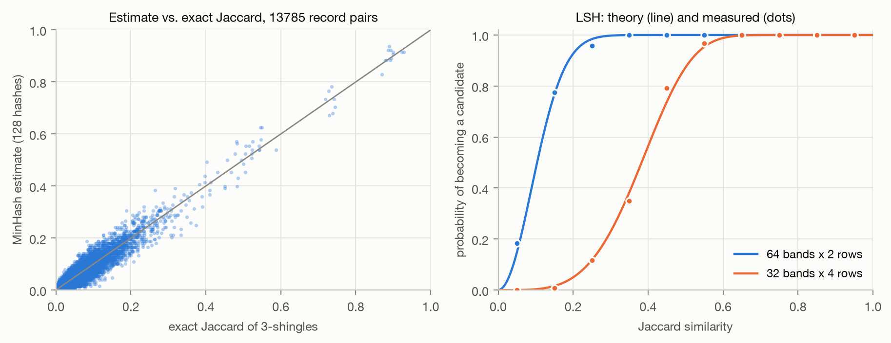
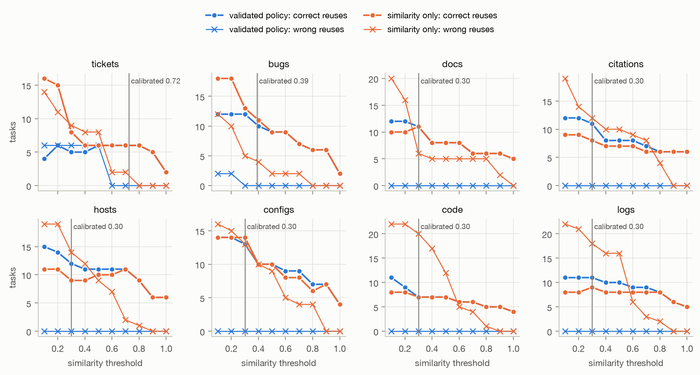

Code: <https://github.com/haotianxia/a2-minhash>. The three required files are `minhash.py`, `policy.py` and `content.py`; `kickoff.py` runs the experiments and `plotty.py` draws the figures.

**Summary.** Each of the four configurations ran on all 420 incoming tasks of eight datasets. Task-level reuse answered 140 tasks by reusing previously verified answers, so the agent did not run on them, and none of these answers failed the verifier. With task-level reuse, input tokens fell by 32%, completion time by 24%, and accuracy rose from 92.4% to 95.5%. Content-level reuse loses no information, but it saves little: replaying the 420 baseline transcripts through it saves 1.7% of the input tokens, and in its own runs the effect stays within run-to-run noise.

# 1. Methodology

**MinHash and LSH (`minhash.py`).** A text is lower-cased and split into alphanumeric tokens, and every three consecutive tokens form a shingle. Each shingle is hashed once with 8-byte BLAKE2b and reduced modulo `p = 2^31 - 1`. Then 128 functions `h_i(x) = (a_i x + b_i) mod p` map it to 128 values, with `a_i` and `b_i` drawn from `numpy.random.default_rng(1115)`. The signature of a text keeps the minimum of each function over its shingle set, and the fraction of positions where two signatures agree estimates the Jaccard similarity of the two sets. `LSH(bands, rows)` cuts a signature into b bands of r rows and stores it in one bucket per band, so two items with similarity J share at least one bucket with probability `1 - (1 - J^r)^b`. Figure 1 checks both parts. On 13,785 pairs of history records the estimate has a mean error below 0.01 in every 0.2-wide bin of J, and its standard deviation is within 0.004 of `sqrt(J(1-J)/128)`. On synthetic pairs the measured LSH candidate rates follow the theoretical curves.

{width=75%}

**Task-level reuse (`policy.py`).** MinHash only measures how alike two tasks look, and a hard negative is a task that looks like a solved one but has a different answer. So the policy uses similarity to find candidates and lets each dataset's published decision rule decide whether an answer carries over. `TaskReuse(dataset_dir)` indexes `env/history.jsonl` and recognises the dataset from the answer fields of its records, so a held-out copy works under any folder name. For each incoming task, in `seq` order, `lookup(task)` does three things:

1. It builds the task text from every field except ids and dates and queries an LSH index with 64 bands of 2 rows. A record with Jaccard similarity 0.3 to the task becomes a candidate with probability 0.998.
2. It keeps the candidates whose estimated similarity is at least the threshold `tau` and whose validation key equals the task's key. The validation key is the set of fields that decide the answer under the rule in the dataset's `INSTRUCTIONS.md` and `README.md` (table below).
3. It reuses an answer only when all kept candidates give the same answer, and copies it from the most similar candidate.

| dataset | validation key |
|---|---|
| tickets | product, error code (`E-1042` = `e1042`), platform |
| bugs | exception class without module, top frame (`a.b.c` or `a/b.py::c`, no line number), version series `major.minor` |
| docs | identifier (`CHG`, `INC`, `POL`, `REL`) and status class (the first class, in the order approved, rejected, request, resolved, open, final, draft, whose stem occurs in the title or body) |
| citations | DOI, title tokens, (surname, initial) of each author in order, venue mapped through the aliases in `db.json`, year |
| the six corpus datasets | scenario, kind, target |

The threshold `tau` is calibrated on the history. It starts at 0.3. Whenever a verified record enters the index and an indexed record with the same key has a different answer, `tau` is raised to the estimated similarity of the two records plus 0.1, unless it is already higher. The margin of 0.1 is slightly more than two standard deviations of the estimate at J = 0.5. Indexing the history alone raises `tau` to 0.725 on tickets and to 0.389 on bugs. On tickets, two history records with the same key and different resolutions have an estimated similarity of 0.625. The other six datasets keep 0.3. Every answer that passes `verify.py` goes into the index, whether the agent wrote it or the policy reused it, so duplicates among the incoming tasks are found too. The policy reads only `env/` and the verifier's pass or fail.

**Content-level reuse (`content.py`).** `ContentReuse().tools(workdir)` returns `read_file`, `grep`, `list_files` and `bash` with their original schemas. Passed to `Harness` as `extra_tools`, they replace the built-in tools, so the harness itself stays unchanged. Every tool output goes through `fold`:

1. Outputs under 400 characters pass unchanged. A longer output is split into parts. A new part starts at every line that is at most 160 characters long and names a scenario file, so a loop that prints `== config/dev.yaml` before each file gives one part per file. If no part reaches 400 characters, as in a grep hit list where every line names a file, the whole output is treated as one part. A `read_file` output is always treated as one part, with its line numbers removed.
2. A part identical to an earlier one becomes a short reference, `[reuse] identical to read_file(path=...) shown earlier (95 lines).`
3. Otherwise the part's signature is computed on a masked copy, in which every hexadecimal token that contains a digit, and every other run of digits, becomes `0`. This signature is looked up in an LSH index of the earlier parts with 32 bands of 4 rows. For each of the three most similar candidates at similarity 0.5 or more, the layer writes an exact line diff (unified format, no context lines) against that candidate's unmasked text, and it keeps the shortest diff.
4. The diff replaces the part only if it is at most 75% as long. Otherwise the part is returned unchanged and becomes a reference for later parts.

Masking only chooses the reference. The diff runs on the exact text, so every number, identifier or configuration line that changed appears in the folded output, and every line the fold leaves out is one the model has already read in the same trajectory. The exactness of the folds was checked on three inputs: the 851 scenario files of the four corpus datasets, each read on its own; their 96 scenarios, each printed by one batched `bash` loop; and the 420 baseline transcripts. These give 829 folds (755 diffs and 74 identical repeats), and expanding each fold from its reference reproduces the original part in all 829 cases. The `INSTRUCTIONS.md` of the corpus datasets tells the agent that a repeated file may come back as a `[reuse]` reference plus the lines that differ.

# 2. Experimental Setup

The experiments use the record datasets tickets, bugs, docs and citations and the corpus datasets hosts, configs, code and logs, with all 420 of their incoming tasks: 70 each for tickets and citations, 60 each for bugs and docs, and 40 for each corpus dataset. According to the manifests, 168 of these tasks (40%) duplicate a history record or an earlier task, and 83 (20%) are hard negatives. All configurations run `gemini-3.5-flash-lite` in the Spartacus harness at commit `711db62` with its default settings (temperature 0.4, a limit of 120 turns). The harness, the datasets and the `verify.py` scripts are unchanged. Each task runs in a fresh directory with `INSTRUCTIONS.md`, `history.jsonl`, `task.json` and the scenario files or `db.json` it needs. Every task gets the same prompt: "Solve the request in task.json: follow INSTRUCTIONS.md and write answer.json in this directory." A task counts as correct when `verify.py` passes. Each (configuration, dataset) pair runs as one stream, and up to 16 streams run in parallel. The task-level and combined streams take their tasks in `seq` order, since a task can reuse the verified answer of an earlier task. Tool calls, requests and tokens come from the harness events. Completion time is the sum of the lookup and agent time of every task, plus the time spent building the index and adding verified answers to it, so it includes all MinHash work.

Individual agent runs are very noisy. At temperature 0.4 one task can use 134 times as many input tokens in one run as in another. Bugs task T-27591a took 5.3M input tokens in the baseline and failed at the 120-turn limit; in the combined configuration, where neither task-level nor content-level reuse acted, it took 40K. For this reason each reused task is compared with the baseline's cost on that same task, and the content layer is also measured by replaying the 420 baseline transcripts through it.

The content-level and combined runs of the first 30 tasks of each corpus dataset come from a later session, run after `content.py` changed how it treats grep hit lists. That session was faster. In it a request took 0.66 s on average, while on the same tasks the baseline averaged 0.75 s and task-level reuse 0.80 s, because a few of their runs stalled at up to 4.4 s per request. The median request time is 0.61 to 0.64 s in all four configurations. Part of the time that content-level and combined reuse save on the corpus datasets therefore comes from the session.

# 3. Results

Table 1. All 420 tasks. Time is the sum of per-task completion times; percentages are relative to the baseline.

| configuration | accuracy | reused (wrong) | tool calls | requests | input tokens | time | MinHash overhead per task |
|-------------|----------------|-------|-------------|-------------|-------------|----------------|----------|
| baseline | 388/420 (92.4%) | | 4,831 | 5,251 | 67.3M | 97.4 min | |
| task-level reuse | 401/420 (95.5%) | 140 (0) | 3,432 (-29%) | 3,712 (-29%) | 46.1M (-32%) | 73.6 min (-24%) | 4.1 ms |
| content-level reuse | 387/420 (92.1%) | | 4,774 (-1%) | 5,191 (-1%) | 64.1M (-5%) | 90.1 min (-7%) | 24.2 ms |
| both | 396/420 (94.3%) | 140 (0) | 3,632 (-25%) | 3,910 (-26%) | 53.0M (-21%) | 74.3 min (-24%) | 15.3 ms |

Task-level reuse carries almost all of the savings. In the baseline, the 140 tasks that task-level reuse answered had used 30% of the tool calls and requests, 29% of the input tokens and 27% of the time, and none of the reused answers failed the verifier. Content-level reuse used 1% fewer tool calls and requests, 5% fewer input tokens and 7% less time than the baseline. Paired bootstrap 95% intervals over the 420 tasks include zero for all of these differences, so they are within noise. Combining both saves about as much time as task-level reuse alone (24%), but its input-token saving is about ten points smaller, 21% against 32% (question 5).

Table 2. Per dataset (70 tasks for tickets and citations, 60 for bugs and docs, 40 for each corpus dataset). Cells list baseline / task-level / content-level / both; the reused column lists task-level / both.

| dataset | correct | reused | input tokens per task (K) | tool calls per task | time per task (s) |
|---------|------------------|--------|---------------------------|---------------------------|---------------------------|
| tickets | 61 / 66 / 68 / 67 | 18 / 18 | 95 / 110 / 88 / 131 | 10.0 / 8.9 / 10.3 / 9.9 | 14.4 / 12.2 / 14.7 / 13.9 |
| bugs | 54 / 57 / 55 / 55 | 20 / 21 | 346 / 144 / 298 / 262 | 13.7 / 7.9 / 13.1 / 9.8 | 18.3 / 12.0 / 16.9 / 14.2 |
| docs | 55 / 60 / 56 / 59 | 23 / 23 | 189 / 148 / 169 / 118 | 11.1 / 8.6 / 10.5 / 7.5 | 16.0 / 12.8 / 13.3 / 10.9 |
| citations | 58 / 59 / 50 / 55 | 25 / 24 | 256 / 216 / 294 / 206 | 14.5 / 10.8 / 14.4 / 11.5 | 19.0 / 14.9 / 18.6 / 15.7 |
| hosts | 40 / 40 / 40 / 40 | 13 / 13 | 58 / 27 / 50 / 33 | 9.9 / 6.2 / 9.2 / 6.1 | 9.1 / 6.6 / 8.2 / 5.9 |
| configs | 40 / 39 / 38 / 40 | 15 / 15 | 82 / 45 / 71 / 46 | 10.3 / 6.9 / 11.4 / 7.2 | 10.1 / 7.8 / 8.9 / 6.1 |
| code | 40 / 40 / 40 / 40 | 12 / 12 | 56 / 34 / 53 / 42 | 9.9 / 6.9 / 9.3 / 7.2 | 8.3 / 6.2 / 7.1 / 5.1 |
| logs | 40 / 40 / 40 / 40 | 14 / 14 | 71 / 38 / 59 / 44 | 10.6 / 6.6 / 10.7 / 7.0 | 8.6 / 5.3 / 7.3 / 4.9 |

Figure 2 plots accuracy against input tokens per task, and Figure 3 shows the per-task metrics of each dataset. Both configurations with task-level reuse use fewer tokens than the baseline on seven of the eight datasets. The exception is tickets. On tickets, each of the two had one runaway run, T-c24ed9 with task-level reuse (2.7M tokens) and T-1cb53c in the combined configuration (4.0M). Either run alone costs more than the 2.0M tokens that the 18 reuses save.

{width=85%}

Figure 4 shows the effect of the threshold. For each threshold from 0.1 to 1.0, the policy is replayed over the same 420 tasks, and every task it does not reuse takes the baseline's answer, which enters the index if it passed `verify.py`. For comparison, Figure 4 also shows plain nearest-neighbour reuse, which takes the answer of the most similar indexed record whenever that record's similarity reaches the threshold.

Inside the content-level runs the layer folded 253 parts in 4,296 tool outputs (Table 3). When the baseline transcripts are replayed through the layer, it makes 201 folds and saves 1.16M input tokens, 1.7% of the baseline. Of this saving, 55% comes from eight trajectories that read `history.jsonl` a second time, and all other folds together save 0.8% of the baseline tokens. On the cost side, task-level work takes 4.1 ms per task including the index build, and the content layer takes 24.2 ms per task (2.4 ms per tool output). An average baseline task takes 13.9 s. Figure 5 sets this overhead against the time saved. To convert tokens into time, agent time is fitted by least squares against requests, input tokens and output tokens over all 1,400 agent runs. In this fit, 1,000 input tokens cost 17 ms, so the tokens the layer removes in the replay are worth only 11 to 157 ms per task. The content-level points in Figure 5 range from 0.22 s lost per task on tickets to 2.71 s saved on docs. These differences are far larger than the 11 to 157 ms that the saved tokens are worth, so they reflect run-to-run variation and, on the corpus datasets, the faster session of Section 2.

{width=60%}

{width=78%}

Table 3. Content layer. Live: the content-level runs. Replay: the 420 baseline transcripts passed through the layer, with tokens saved estimated as a quarter of the removed characters times the number of later requests. Scenario files: every file of every corpus scenario, read one by one.

| dataset | live: parts folded / outputs | replay: folds (identical) | replay: share of baseline tokens saved | scenario files: characters kept |
|---------|------------|------------|------------|------------|
| tickets | 24 / 642 | 24 (20) | 0.69% | |
| bugs | 30 / 712 | 15 (5) | 0.97% | |
| docs | 55 / 558 | 41 (8) | 4.95% | |
| citations | 30 / 932 | 31 (14) | 0.63% | |
| hosts | 3 / 328 | 10 (5) | 2.12% | 66% |
| configs | 74 / 415 | 40 (0) | 2.22% | 57% |
| code | 15 / 324 | 19 (2) | 3.27% | 42% |
| logs | 22 / 385 | 21 (20) | 1.50% | 100% |

{width=60%}

# 4. Discussion

**1. When is task reuse beneficial?** Task reuse pays off when an incoming task repeats a verified one and the answer depends only on information that both texts contain. Such a task needs no agent run at all: once the validation keys match and the similarity is at least `tau`, the policy writes the stored answer after a lookup of about 0.4 ms. The baseline got 134 of the 140 reused tasks right, and reuse got all 140. Reuse therefore accounts for 6 of the 13 extra tasks that task-level reuse solved (401 against 388), and the other 7 come from run-to-run variation in the agent runs. The most suitable tasks are templated requests whose key fields are explicit. Questions on hosts, configs, code and logs name a scenario and a question kind. On each of these datasets 12 to 15 of the 40 tasks were reused, worth 30% to 39% of its baseline input tokens. Docs requests carry a CHG, INC, POL or REL number, and citation requests carry a title, authors, venue, year and, in most cases, a DOI. Reuse covered 23 of the 60 docs tasks and 25 of the 70 citations tasks. Free-text tickets are the weakest case, with 18 of 70 reused (26%, against 30% to 38% elsewhere). Their resolution depends on the two sentences of the body that describe the cause, so history pushes their threshold up to 0.725. Indexing verified answers also matters: 35 of the 140 reuses matched an earlier incoming task.

**2. Is high similarity sufficient for safe reuse?** No. In docs, task T-b7e9fb and history record H-4b14df have an estimated similarity of 0.93. Both describe the POL-534 policy for the Payroll Gateway and match word for word, except that the task says twice that the policy is in draft, while the record says it is in force. The record's answer, policy-final, therefore fails for the task. In citations, T-25850c and H-cf84aa have an estimated similarity of 0.89 and differ only in the first author's surname: the task has Petrv where the record has Petrov. The task's verdict must therefore also list `authors` among its wrong fields. The validation key rejects both pairs, since the status class and the author list differ. The tickets pair T-27a7f4 and H-f01546 is harder. The two share product, error code and platform and have an estimated similarity of 0.59. They differ in one paragraph, which describes a power failure during a sync in the task and a self-update on Tuesday in the record, and their resolutions differ. This pair has the same validation key, so only the calibrated threshold of 0.725 stops it. Over the 420 tasks the most similar LSH candidate carried a wrong answer for 224 tasks, and the policy reused none of those answers.

**3. How does the similarity threshold affect performance?** A lower threshold reuses more duplicates and also lets more hard negatives through (Figure 4). Plain nearest-neighbour reuse is wrong for 112 of 229 reuses at 0.5 and still for 6 of 86 at 0.9. With the key check, only tickets and bugs need a threshold at all. On the other six datasets the key alone blocks every hard negative, and a threshold of 0.1 would add 14 correct reuses to the 102 found at 0.3.

On tickets the policy reuses 9 wrong answers at 0.5 and still one at 0.6: T-e08d15 takes the resolution of H-1b89e5 at an estimated similarity of 0.602, although the exact Jaccard similarity of the two texts is 0.548. All nine wrong reuses at 0.5 lie at an exact similarity of 0.52 to 0.55, where one 128-function estimate has a standard deviation of 0.044. A fixed threshold on tickets therefore needs a margin of about two standard deviations above these pairs, which puts it around 0.65. The bugs dataset has no wrong reuses from 0.3 up in this sweep.

So a single threshold for every dataset gives up either correctness or reuse. A threshold of 0.3 everywhere gives 154 reuses with 10 wrong, 0.6 gives 122 with 1 wrong, and 0.7 gives 109 with none, while the per-dataset thresholds calibrated from history give 140 reuses with none wrong. The calibrated 0.725 on tickets comes from history pairs that share a key and have different answers. Their estimated similarity is 0.625 while their exact similarity is about 0.55, as for the wrong reuses above, so the margin of 0.1 covers the same estimation error.

**4. When is content-level reuse effective?** When one trajectory reads the same or nearly the same text more than once. Code shows the near-duplicate case most clearly. On code the replay saves 3.3% of the baseline input tokens, and 71% of that saving comes from `read_file` diffs between sibling adapters. In the combined run of code task T-b372a7, `adapters/checkout.py` (4,222 characters) came back as a 1,124-character diff against `adapters/adyen.py`. The diff lists the name, base URL, signature header, decline codes and class name, plus the two lines where checkout behaves differently: its retry loop is one attempt shorter, and its `refund` sends the idempotency key.

On logs the same approach saves almost nothing. With digits masked, the log files of a scenario look alike: the median similarity of a file to the closest earlier file is 1.0. But nearly every line differs in its timestamp or request id, so the exact diff is about twice as long as the file, and the layer returns the original. Almost all of the 1.5% saved on logs in the replay comes from 20 exact repeats, 18 of which are greps for ERROR over `logs/`. The record datasets contain no near-duplicate files. Tickets and citations save under 0.7%, and on docs and bugs, 73% and 91% of the saving come from seven trajectories that read `history.jsonl` a second time. In the content-level runs the layer removed 4.2% of the input tokens, and 72% of that came from ten repeated reads of `history.jsonl`. Both this saving and the replay saving mostly measure how often an agent happens to read a large file twice.

**5. Which optimization is more valuable?** Task-level reuse, by a wide margin. It cut tool calls and requests by 29%, input tokens by 32% and time by 24%, and raised accuracy from 92.4% to 95.5%. Content-level reuse only shortens tool outputs, so by itself it removes no tool calls or requests. It saves 1.7% of the input tokens in the replay and 4.2% in its own runs, and these savings fall to 0.8% and 1.2% once the `history.jsonl` re-reads are left out. Little of its 7% time saving comes from the layer. Under the time fit of Section 3, its whole difference from the baseline in requests and tokens accounts for 2.3 of the 7.3 minutes saved. The 120 corpus tasks of the faster session saved 1.8 minutes more than the fit predicts for them. Folding did not hurt accuracy. Content-level reuse is within one task of the baseline (387 against 388), and its 124 runs with at least one fold passed 112 times against 111 for the baseline on the same tasks. On citations it passed 8 fewer tasks than the baseline, and 6 of that gap falls in the 49 runs where the layer folded nothing, which passed 35 times against 41 for the baseline. Both overheads, 4 ms and 24 ms per task, are negligible next to an agent run of 13.9 s.

Combining the two saved fewer tokens than task-level reuse alone: 53.0M against 46.1M. Three runaway combined runs account for this: bugs T-704c01 (5.4M), tickets T-1cb53c (4.0M) and citations T-24c0bd (2.5M). The layer folded nothing in any of them. Together these three runs used 11.0M more tokens than the same tasks with task-level reuse alone, which is more than the whole gap of 6.9M.

Task-level reuse is the better choice whenever requests repeat and both a verifier and a validation key are available, as in bug triage, citation checks or templated operations questions. Content-level reuse fits the opposite case: every task is new and there is no verified history, but the agent reads families of near-identical files, such as per-environment configs or copy-pasted adapters. Its diffs are exact, so it needs no verifier.

**6. What are the limitations of MinHash for agents?**

- *Paraphrases share few shingles.* In code, T-2a8e03 asks which adapter breaks rule R2 on `TIMEOUT_S`, and H-cb9c70 asks which cashier adapter drifted on its HTTP timeout constant. Both concern scenario SDK-1722 and have the same answer, yet their estimated similarity is only 0.10. In the task-level runs, 30 tasks went to the agent even though an indexed record with the same key had the right answer, because that record's similarity was below the dataset's threshold.
- *The key has to be written for each dataset.* One token can change the answer at similarity 0.9 (question 2), so MinHash needs a validation key derived from a published decision rule. The calibration also learns only from history pairs that share a key and have different answers. A short history without such a pair leaves `tau` at 0.3, which lets wrong reuses through on tickets (question 3).
- *Overhead can exceed savings.* Under the time fit of Section 3, the 654 tokens the layer saves per tickets task in the replay are worth 11 ms. In the content-level runs, where all streams share one Python process, the layer spent 29 ms per tickets task, against 6 ms when the replay runs alone. Task-level reuse is the opposite case: 1.7 s of MinHash time in total saved 23.7 minutes.

One improvement is to group records by validation key and compare the free text within each group with a sentence embedding, keeping the agreement rule and a threshold calibrated like `tau`. The SDK-1722 pair has the same key, subject line and meaning, yet its two texts share few shingles (exact Jaccard 0.13), so an embedding could recover such paraphrases, as long as same-key hard negatives, such as the tickets pair in question 2, stay below the new threshold.

# 5. Reproducing

```bash
git clone https://github.com/haotianxia/a2-minhash && cd a2-minhash
python3 -m venv .venv && . .venv/bin/activate   # Python 3.13
pip install -r requirements.txt   # numpy, matplotlib and Spartacus at commit 711db62
export GEMINI_API_KEY=...
python kickoff.py run --workers 16 --out out2
python kickoff.py summary --out out2
python kickoff.py sweep --out out2
python kickoff.py replay --out out2
python kickoff.py trajectories --out out2
python kickoff.py plots --out out2
python kickoff.py run --datasets assignment2/datasets/<folder> --out <new folder>
```

`out/` holds the reported run: rows in `out/results/`, tables in `out/tables.md`, figures in `out/plots/`, and every task's working directory with its harness log in `out/runs.tar.gz`. After `tar xzf out/runs.tar.gz -C out`, running `summary`, `sweep`, `replay`, `trajectories` and `plots` without `--out` recomputes the tables and figures with no model calls. A held-out dataset folder with any name, holding its `env/`, `hidden/` and a copy of its `verify.py`, goes under `assignment2/datasets/` and runs with the last command above. MinHash uses seed 1115 and banding has no randomness, so the same transcripts always give the same reuse decisions, folds, sweep and replays, apart from measured times. The agent samples at temperature 0.4 without a seed.
