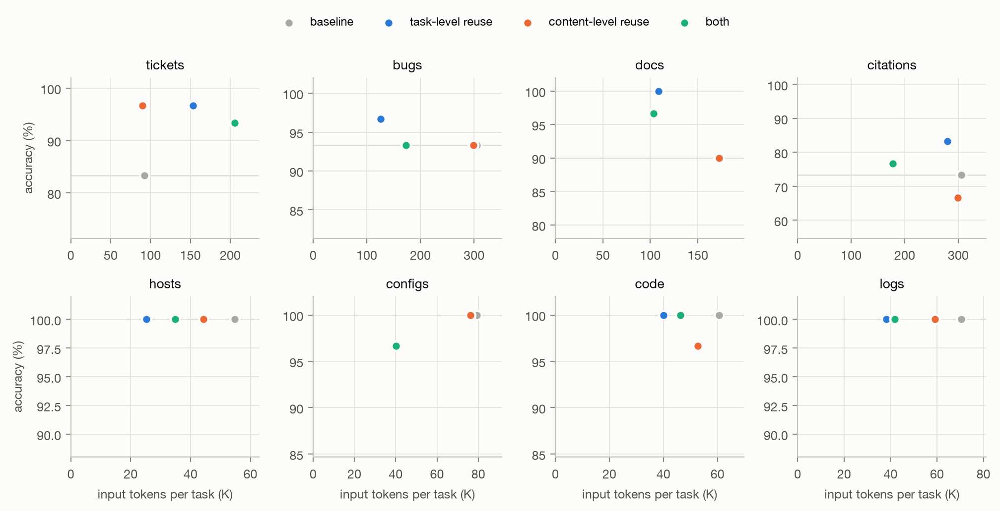
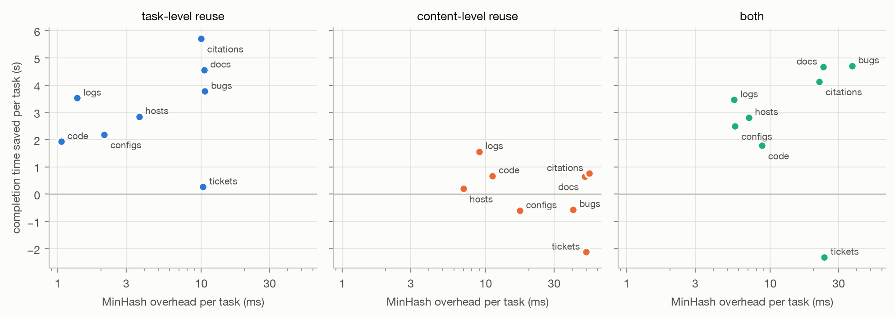

Code: <https://github.com/haotianxia/a2-minhash>. The three required files are `minhash.py`, `policy.py` and `content.py`; `kickoff.py` runs the experiments and `plotty.py` draws the figures.

# 1. Methodology and Implementation

The three files share one representation. A text is lower-cased and split into alphanumeric tokens, and every three consecutive tokens form a shingle. `MinHash` in `minhash.py` hashes each shingle once with 8-byte BLAKE2b, reduces it modulo `p = 2^31 - 1` and applies 128 functions `h_i(x) = (a_i x + b_i) mod p`, with `a_i` and `b_i` drawn from `numpy.random.default_rng(1115)`. A signature stores the minimum of each function over the set, and the fraction of equal positions in two signatures estimates their Jaccard similarity. `LSH(bands, rows)` splits a signature into bands and files the item under each band's bytes; a query returns every item that shares at least one bucket, which happens with probability `1 - (1 - J^r)^b`. On 13,785 pairs of history records the estimate has a bias below 0.01 in every similarity bin and a standard deviation within 0.004 of the theoretical `sqrt(J(1-J)/128)`, and on synthetic set pairs (120 pairs of 400-element sets per similarity level) the measured LSH candidate rates follow the theoretical curves (Figure 1). Measured on their own, a task signature takes about 0.1 ms, a lookup 0.1 to 0.25 ms, and indexing the 140 history records of tickets (83 KB) 17 ms. Inside the experiment, where 16 streams run as threads of one Python process, lookups took 0.4 ms (median) and the index builds of the record datasets 200 to 275 ms; Table 1 reports these in-run times.

{width=100%}

**Task-level reuse (`policy.py`).** `TaskReuse(dataset_dir)` indexes every record of `env/history.jsonl`. For each incoming task, in `seq` order, `lookup(task)`:

1. builds the task text from every field except ids and dates (for tickets: product, error code, platform, subject and body) and queries an LSH index with 64 bands of 2 rows, which returns a record at Jaccard 0.3 with probability 0.998;
2. keeps the candidates whose estimated similarity is at least `tau` and whose validation key equals the task's key (table below);
3. reuses an answer only when all kept candidates carry the same answer under `norm_answer_value`, the corpus verifiers' normalisation applied to every field except `duplicate_of`, and takes it from the most similar one. For the record datasets this is stricter than their verifiers (`R-7` and `R-07` count as different), which can only make the policy more cautious. On docs, reusing a history record sets `duplicate_of` to that record's id, and reusing an earlier task copies its verified answer.

| dataset | validation key (the rule published in each `INSTRUCTIONS.md`) |
|---|---|
| tickets | product, error code (`E-1042` = `e1042`), platform |
| bugs | exception class without module, top frame (`a.b.c` or `a/b.py::c`, no line number), version series `major.minor` |
| docs | identifier (`CHG`, `INC`, `POL`, `REL`) and status class (the first class, in the order approved, rejected, request, resolved, open, final, draft, whose stem occurs in the title or body) |
| citations | DOI, title tokens, (surname, initial) of each author in order, venue mapped through the aliases in `db.json`, year |
| hosts, configs, code, logs | scenario, kind, target |

The threshold `tau` starts at 0.3 and is raised by the data. Each time a verified record enters the index it is compared with the indexed records that have the same key; if one of them has a different answer, `tau` becomes `max(tau, similarity + 0.1)`. The margin of 0.1 is slightly more than two standard deviations of the estimate at J = 0.5. History alone sets `tau` to 0.725 on tickets, where two records with the same key and different resolutions reach 0.625, and to 0.389 on bugs; on the other six datasets no two records with the same key disagree and `tau` stays at 0.3. No task of the experiment moved it further. When the agent's answer to a task passes `verify.py`, `add(tid, task, answer)` indexes the task, so later duplicates of incoming tasks are found as well; a reused answer is indexed the same way once it passes. The policy reads only `env/` and the verifier's pass or fail.

**Content-level reuse (`content.py`).** `ContentReuse().tools(workdir)` returns `read_file`, `grep`, `list_files` and `bash` with their original schemas. Passed to `Harness` as `extra_tools`, they replace the built-in tools of the same name, so the harness code stays unchanged. Every output goes through `fold`:

1. Outputs under 400 characters pass unchanged. Line numbers of `read_file` are removed for the comparison. Any other output is split into parts, a new part starting at each line of at most 160 characters that names a file of the scenario directory, so a loop that prints `== config/dev.yaml` before each file gives one part per file.
2. A part identical to an earlier one becomes a single line, `[reuse] identical to read_file(path=...) shown earlier (95 lines).`, which names the earlier output by its tool and the first 100 characters of its arguments.
3. Otherwise the part's signature is computed with every digit run and hexadecimal id replaced by `0`, and an LSH index with 32 bands of 4 rows over the earlier parts returns candidates. For the three most similar candidates with similarity of at least 0.5 the layer writes an exact line diff (unified format, no context lines) against the earlier, unmasked text and keeps the shortest.
4. The diff replaces the part only if it is at most 75% as long as the part. Otherwise the part is returned unchanged and becomes a reference for later parts.

Masking only decides which earlier part to compare against. The diff is computed on the exact text, so every number, identifier or configuration line that differs appears in the folded output, and every line not listed equals a line the model has already read in the same trajectory. Only parts returned in full become references, so no fold depends on another fold. I replayed through the layer all 851 scenario files of hosts, configs, code and logs one by one, the same 96 scenarios printed by one batched `bash` loop each (which the harness cuts to 12,000 characters), and the 240 baseline transcripts. This produced 723 folds, and applying each diff to its reference reproduced the original part in all 723 cases.

# 2. Experiments

I use eight datasets: the record datasets tickets, bugs, docs and citations, and the corpus datasets hosts, configs, code and logs. To keep the cost of four configurations low I run the first 30 incoming tasks (by `seq`) of each dataset, 240 tasks in all. According to the published manifests, 40% of all incoming tasks duplicate a history record or an earlier task (as exact copies, reformatted, reordered, edited or paraphrased) and 20% are hard negatives.

All four configurations run the same 240 tasks with `gemini-3.5-flash-lite` through the unmodified Spartacus harness (commit `711db62`). The harness fixes the temperature at 0.4 and the turn limit at 120. Each task runs in a fresh working directory with `INSTRUCTIONS.md`, `history.jsonl` and `task.json`, plus `db.json` for citations and, for corpus tasks, the scenario folder the task refers to. Every task gets the same prompt: "Solve the request in task.json: follow INSTRUCTIONS.md and write answer.json in this directory." A task is correct when the dataset's `verify.py` passes on the written `answer.json`. Within a (configuration, dataset) stream the tasks run in `seq` order, so task-level reuse can use answers verified earlier in the same stream; 16 streams run in parallel.

Tool calls, model requests and input and output tokens are counted from the harness events. Completion time is the wall-clock time per task from the lookup to the end of the agent run, summed over tasks. It includes all MinHash work: building the index, the lookup, indexing a verified answer and folding tool outputs, which I also report on its own as overhead. A reused task costs no tool calls, requests or tokens.

With temperature 0.4 one task can use 35 times as many input tokens in one run as in another. Tickets T-1cb53c took 9 requests and about 115K input tokens in three configurations and 121 requests and 4.0M tokens in the fourth, where neither layer changed anything (no reuse, no folded output). Seven of the 797 agent runs used more than 1M tokens and together account for 14% of all agent tokens. I therefore compare each reused task with the baseline's cost on that same task, and I measure the content layer a second time by replaying the 240 baseline transcripts through it, which removes the sampling noise.

# 3. Results

Table 1. All 240 tasks. Time is the sum of per-task completion times; percentages are relative to the baseline. Output tokens are 0.07M to 0.11M per configuration and are left out.

| configuration | accuracy | reused (wrong) | tool calls | requests | input tokens | time | MinHash overhead per task |
|-------------|----------------|-------|-------------|-------------|-------------|----------------|----------|
| baseline | 222/240 (92.5%) | | 2,598 | 2,838 | 34.2M | 51.2 min | |
| task-level reuse | 232/240 (96.7%) | 82 (0) | 1,839 (-29%) | 1,997 (-30%) | 24.4M (-29%) | 38.8 min (-24%) | 6.2 ms |
| content-level reuse | 223/240 (92.9%) | | 2,611 (+1%) | 2,849 (+0%) | 32.8M (-4%) | 50.9 min (-1%) | 29.6 ms |
| both | 227/240 (94.6%) | 81 (0) | 1,919 (-26%) | 2,076 (-27%) | 24.7M (-28%) | 40.3 min (-21%) | 16.7 ms |

Task-level reuse removes 82 agent runs and with them about 30% of the tool calls, requests and input tokens and 24% of the time, and accuracy rises from 92.5% to 96.7%; none of the 82 reused answers failed the verifier. Content-level reuse leaves tool calls and requests unchanged and lowers input tokens by 4%, which is within the run-to-run variation. Combining both saves slightly less than task-level reuse alone, 1 to 3 points on each metric.

Table 2. Per dataset, 30 tasks each. Cells list baseline / task-level / content-level / both; the reused column lists task-level / both.

| dataset | correct | reused | input tokens per task (K) | tool calls per task | time per task (s) |
|---------|------------------|--------|---------------------------|---------------------------|---------------------------|
| tickets | 25 / 29 / 29 / 28 | 7 / 7 | 92 / 153 / 90 / 206 | 9.3 / 10.4 / 10.9 / 12.1 | 15.3 / 15.1 / 17.5 / 17.6 |
| bugs | 28 / 29 / 28 / 28 | 10 / 10 | 305 / 126 / 299 / 173 | 12.2 / 7.9 / 12.7 / 8.2 | 16.7 / 12.9 / 17.2 / 12.0 |
| docs | 27 / 30 / 27 / 29 | 11 / 11 | 172 / 109 / 173 / 103 | 10.0 / 7.1 / 10.5 / 6.6 | 16.0 / 11.5 / 15.4 / 11.4 |
| citations | 22 / 25 / 20 / 23 | 11 / 10 | 306 / 280 / 299 / 178 | 14.6 / 9.8 / 13.6 / 10.7 | 20.9 / 15.2 / 20.2 / 16.8 |
| hosts | 30 / 30 / 30 / 30 | 12 / 12 | 55 / 25 / 44 / 35 | 9.6 / 5.6 / 9.3 / 5.3 | 7.7 / 4.9 / 7.5 / 4.9 |
| configs | 30 / 29 / 30 / 29 | 13 / 13 | 79 / 41 / 76 / 40 | 10.0 / 6.4 / 10.8 / 6.5 | 8.5 / 6.3 / 9.1 / 6.0 |
| code | 30 / 30 / 29 / 30 | 7 / 7 | 61 / 40 / 53 / 46 | 10.4 / 7.7 / 9.8 / 8.0 | 8.2 / 6.3 / 7.6 / 6.4 |
| logs | 30 / 30 / 30 / 30 | 11 / 11 | 71 / 38 / 59 / 42 | 10.5 / 6.5 / 9.4 / 6.5 | 9.1 / 5.5 / 7.5 / 5.6 |

Figure 2 plots accuracy against input tokens per task for each configuration, and Figure 3 shows every metric per dataset. Both configurations with task-level reuse use fewer tokens than the baseline on seven of the eight datasets. On tickets each of them had one runaway agent run, T-c24ed9 with task-level reuse (85 requests, 2.7M tokens) and T-1cb53c in the combined configuration (4.0M tokens), and each outweighs the 0.8M tokens that the seven reuses save.

{width=100%}

{width=100%}

Table 3 pairs each task-level run with the baseline run of the same task. On the 82 reused tasks the baseline agent spent 11.2M input tokens (a third of its total), 825 tool calls, 907 requests and 864 s, and solved 76 of them. On the other 158 tasks both configurations ran the same agent, so their difference measures noise; the task-level stream used 24.4M tokens there against the baseline's 23.0M, and the per-dataset medians move in both directions.

Table 3. Task-level reuse configuration, paired with the baseline on the same task ids.

| dataset | reused (history / earlier task) | baseline correct on these | baseline tokens on these (K) | share of baseline tokens | other tasks: tokens, task-level / baseline (K) | other tasks: median (K) |
|---------|------------|--------|--------|--------|------------------|----------|
| tickets | 7 (4 / 3) | 5/7 | 817 | 29% | 4,594 / 1,955 | 66 / 40 |
| bugs | 10 (8 / 2) | 10/10 | 2,841 | 31% | 3,777 / 6,320 | 151 / 161 |
| docs | 11 (10 / 1) | 10/11 | 1,506 | 29% | 3,262 / 3,658 | 184 / 162 |
| citations | 11 (9 / 2) | 8/11 | 3,517 | 38% | 8,387 / 5,664 | 273 / 276 |
| hosts | 12 (10 / 2) | 12/12 | 698 | 42% | 757 / 945 | 38 / 45 |
| configs | 13 (10 / 3) | 13/13 | 675 | 28% | 1,230 / 1,705 | 33 / 59 |
| code | 7 (6 / 1) | 7/7 | 407 | 22% | 1,199 / 1,413 | 46 / 50 |
| logs | 11 (8 / 3) | 11/11 | 733 | 35% | 1,146 / 1,384 | 47 / 49 |
| all | 82 (65 / 17) | 76/82 | 11,194 | 33% | 24,353 / 23,043 | |

Figure 4 replays the policy over the same 240 tasks for thresholds from 0.1 to 1.0, using the baseline's verified answers for the tasks it does not reuse, and counts reuses whose answer fails the verifier. The validated policy is compared with plain nearest-neighbour reuse, which takes the answer of the most similar indexed record whenever its similarity reaches the threshold.

{width=100%}

Table 4. Content layer. Inside the agent: the content-level runs. Replay: the 240 baseline transcripts passed through the layer; tokens saved are estimated as a quarter of the removed characters, multiplied by the number of later requests. Scenario files: every file of every corpus scenario, read one by one.

| dataset | inside the agent: parts folded / outputs | output characters kept | replay: folds (identical) | replay: tokens saved (K) | replay: share of baseline tokens | scenario files: characters kept |
|---------|------------|----------|------------|----------|------------|------------|
| tickets | 13 / 293 | 97.5% | 8 (8) | 16 | 0.57% | |
| bugs | 11 / 347 | 99.5% | 6 (2) | 186 | 2.04% | |
| docs | 35 / 281 | 86.1% | 14 (5) | 259 | 5.02% | |
| citations | 13 / 376 | 99.7% | 11 (6) | 50 | 0.55% | |
| hosts | 2 / 248 | 99.6% | 7 (3) | 6 | 0.36% | 66% |
| configs | 39 / 293 | 95.6% | 30 (0) | 61 | 2.58% | 57% |
| code | 30 / 262 | 87.1% | 18 (2) | 73 | 4.01% | 42% |
| logs | 3 / 248 | 99.4% | 1 (1) | 1 | 0.04% | 100% |

Inside the content-level runs the layer folded 146 parts in 2,348 tool outputs. Replaying the baseline transcripts gives 95 folds, 27 of them identical repeats, and saves 0.65M input tokens, 1.9% of the baseline. Task-level work costs 6.2 ms per task including the index build, and the content layer 3.0 ms per tool output (29.6 ms per task), against a mean agent time of 12.8 s per task. Figure 5 plots this overhead against the completion time saved per task.

{width=100%}

# 4. Discussion

1. **When is task reuse beneficial? Which tasks are most suitable, and when can a duplicate eliminate agent execution?** Reuse pays when a task repeats a verified task and the answer depends only on information both texts contain. A duplicate replaces the agent entirely when the fields that decide the answer, as published in `INSTRUCTIONS.md`, agree and the two texts are similar enough (above `tau`) that no other detail can change the answer; the policy then writes the stored answer in well under a millisecond. The 82 reused tasks account for 32% of the baseline's tool calls, 32% of its requests, 33% of its input tokens and 28% of its time. The baseline solved 76 of them, and every reused answer passed. Task-level reuse solves 10 more tasks than the baseline (232 against 222). Six are reused tasks the baseline failed, and the other 4 are the net result of chance in the agent runs, where 8 tasks passed only with task-level reuse and 4 only in the baseline (150 against 146 of the same 158 tasks). The best candidates are templated requests whose decisive fields are explicit. Hosts, configs and logs questions name a scenario and a question kind, and they had 12, 13 and 11 reuses out of 30, worth 42%, 28% and 35% of the baseline tokens. Docs requests carry a CHG, INC or POL identifier, and citations a DOI, title and author list. Free-text tickets are among the weakest cases. Their resolution depends on one sentence about the cause, so they get the highest calibrated threshold (0.725); the policy reused 7 of 30, and 4 more tickets had a same-key record with the right answer at similarity 0.20 to 0.29, below same-key conflicts that reach 0.59. Earlier incoming tasks supplied 17 of the 82 reuses, each matching a task the agent had solved earlier in the same stream.

2. **Is high similarity sufficient for safe reuse?** No. In docs, task T-b7e9fb and history record H-4b14df have an estimated similarity of 0.93. Both are the POL-534 policy for the Payroll Gateway and are word for word the same, except that the task says twice that the policy is in draft where the record says it is in force, so the record's answer, policy-final, fails. In citations, T-25850c and H-cf84aa reach 0.89 and differ only in the first author's surname, Petrv instead of Petrov, so the task's verdict must also list `authors` among its wrong fields. In tickets, T-27a7f4 and H-f01546 share product, error code and platform and reach 0.59; the one different paragraph describes a power failure during a sync in the task and a self-update on Tuesday in the record, and the resolutions differ. Over the 240 tasks the most similar indexed record carried a wrong answer for 132 tasks, and the policy reused none of those answers. The validation key rejects the first two examples, since the status class and the author list differ. The calibrated threshold handles same-key conflicts like the tickets pair. Among the first 30 tickets tasks, 16 have an indexed record with the same key and a wrong answer; the 7 that clear the 0.3 floor lie at 0.48 to 0.59, below `tau` = 0.725. When several candidates pass both checks, their answers must also agree.

3. **How does the similarity threshold affect performance?** A lower threshold finds more duplicates and more hard negatives at the same time (Figure 4). Without validation, nearest-neighbour reuse is wrong for 71 of 136 reuses at 0.5, 30 of 88 at 0.7, 17 of 69 at 0.8 and 2 of 49 at 0.9. Only tasks whose token sequence equals a record's (similarity 1.0, 34 tasks: 19 exact copies and 15 that differ only in case, punctuation or line breaks) are always safe. With the key check, only tickets and bugs need a threshold to avoid wrong reuses. On docs, citations and the four corpus datasets the key alone blocks every hard negative, and a threshold of 0.1 would add 10 correct reuses to the 65 found at 0.3. On tickets every threshold up to 0.5 reuses 6 wrong answers and 0.6 is the first safe value; bugs needs at least 0.3. A single threshold therefore gives up either correctness or reuse. A threshold of 0.3 everywhere gives 88 reuses with 6 wrong, 0.6 gives 66 with none wrong, and the per-dataset thresholds calibrated from history give 81 with none wrong. The calibration needs no labels and runs on any held-out dataset, but it only raises the threshold, so it keeps the 0.3 floor where the key alone would be enough.

4. **When is content-level reuse effective?** It helps when one trajectory reads the same or nearly the same text more than once. Docs gains the most, 5.0% of its input tokens in the replay, and inside the agent the layer kept 86% of its output characters (Table 4). Three patterns produce the folds. The agent re-reads a file it has already seen; replaying the baseline transcript of bugs T-045598, the second read of `history.jsonl` (122,697 characters) becomes a 77-character line. The agent reads sibling files one by one; in code T-b372a7, `adapters/checkout.py` came back as a 1,124-character diff against `adapters/adyen.py` instead of 4,222 characters, listing the name, base URL, signature header, decline codes and class name plus the two lines where checkout behaves differently, a retry loop one attempt shorter and a `refund` that sends the idempotency key. Repeated greps return the same matches plus new lines from the harness's own session log under `.spartacus/`, which `grep` also searches (6 of the 14 docs folds). When a whole scenario is read file by file, the layer keeps 42% of the characters on code, 57% on configs and 66% on hosts. Logs gains almost nothing. With digits masked, the log files of a scenario look alike (every file after the first has a candidate, median similarity 1.0), but nearly every line differs in its timestamp or request id, so the exact diff is about twice as long as the file and the 75% rule returns the original. The 30 logs trajectories do repeat 15 outputs of at least 400 characters exactly, mostly greps for ERROR over `logs/`, but the layer folds only one of them, because every hit line names a log file and becomes a part header with an empty body. Treating such a hit list as one part would fold all 15 and raise the logs saving from 0.04% to 1.6%. Tickets, citations and hosts gain less than 0.6% because a trajectory almost never reads the same large file twice (`INSTRUCTIONS.md`, `history.jsonl`, `db.json`), and its greps, about 5% of the output characters, return short matches that rarely repeat. The live numbers in Table 2 cannot resolve effects this small; content-level reuse used 19% fewer tokens than the baseline on hosts, where it folded 2 of 248 outputs.

5. **Which optimization is more valuable?** Task-level reuse, by a wide margin on these datasets. It cut tool calls by 29%, requests by 30%, input tokens by 29% and time by 24%, and raised accuracy from 92.5% to 96.7%, mostly because reused answers come from verified tasks (6 of the 10 extra passes, question 1). Content-level reuse only shortens outputs, so it cannot remove tool calls or requests (2,611 calls against 2,598); its saving is 1.9% of input tokens in the replay and 4% live. Its accuracy of 92.9% matches the baseline's 92.5%, and the 60 content-level runs with at least one fold passed 55 times where the baseline passed 54 of the same tasks. It costs 30 ms per task against 6 ms for task-level reuse, both negligible next to the 12.8 s of an agent run. The combination used 24.7M tokens against 24.4M for task-level reuse alone; the expected extra saving, about 2% of the remaining agent tokens, is smaller than the noise. I would use task-level reuse whenever requests repeat and a verifier and a decisive key exist, as in support tickets, bug triage or citation checks. Content-level reuse suits workloads where every task is new and there is no verified history, but trajectories read families of near-identical files such as per-environment configs or copy-pasted adapters. Since its diffs are exact it loses no information even without a verifier, although a diff can still steer the model to a wrong answer (question 6).

6. **What are the limitations of MinHash for agents?**

   - Paraphrases share few shingles. 17 agent tasks of the task-level stream had an indexed record with the same key and an answer that passes, at similarity 0.10 to 0.34, below the threshold. In code, T-2a8e03 asks which adapter breaks rule R2 on `TIMEOUT_S` and H-cb9c70 asks which cashier adapter drifted on its HTTP timeout constant; both concern scenario SDK-1722, have the same answer, and reach a similarity of 0.10.
   - One token can change the answer at similarity 0.9 (question 2), so MinHash needs a validation key written for each dataset. A dataset whose decision rule is not published would need someone to work it out first.
   - Most of an agent's cost is context that is re-sent with every request, and the layer only sees new outputs. In the combined run of tickets T-1cb53c the agent called `grep` 102 times with the error code as both regex and file glob, got a 23-character no-match line each time and stopped at the 120-turn limit after 4.0M input tokens. Those outputs were under the 400-character floor, while the `history.jsonl` it read on its seventh call (83,556 characters with line numbers) was re-sent with each of the remaining requests.
   - An exact diff can still mislead the model. In the content-level run of code T-b372a7, `adyen.py` was the only adapter whose `refund` sent no idempotency key. It was read first, so the five other adapters came back as diffs that each added that key, and the model answered `paypal.py`; the baseline and the combined run, which saw the same five diffs, answered `adyen.py`. References are also named by the tool and the first 100 characters of its arguments, so repeated `python3 -c` scripts can share one name.
   - The harness keeps only 12,000 characters of a `bash` output and cuts the middle, so a batched print of a scenario loses files before the layer sees them. All 96 batched prints of the corpus scenarios are longer than that, and in configs T-602bce the agent's own loop over the config files came back as 12,029 characters, the 12,000 kept plus the cut notice.
   - The overhead can buy almost nothing. On logs the content layer spends 9 ms per task to save about 30 input tokens per task (0.04%).

   One improvement: use the validation key as the blocking key and compare the free text of the requests inside each block with a sentence embedding, keeping the agreement rule and a threshold calibrated the same way on the new score. Paraphrases such as the SDK-1722 pair share the key and the meaning but almost no shingles, so a semantic score could recover reuses like the 17 above, while same-key hard negatives such as the tickets pair in question 2 would still fall below the calibrated threshold.

# 5. Reproducing

```bash
pip install -r requirements.txt   # numpy, matplotlib and Spartacus at commit 711db62
export GEMINI_API_KEY=...
python kickoff.py run --limit 30 --workers 16
python kickoff.py summary --limit 30
python kickoff.py sweep --limit 30
python kickoff.py replay
python kickoff.py trajectories --limit 30
python kickoff.py plots --limit 30
```

Results go to `out/`: one JSON row per task and configuration in `out/results/`, the harness session of every task in `out/runs/`, the tables in `out/tables.md` and the figures in `out/plots/`. The repository contains the reported run, with the sessions packed in `out/runs.tar.gz` (extract it with `tar xzf out/runs.tar.gz -C out` before `trajectories`). Since `run` resumes from saved rows, a fresh run needs a new folder: add `--out out2` to every command. MinHash and LSH use seed 1115, so signatures, reuse decisions, folds, the threshold sweep and both replays are deterministic for given transcripts. The harness fixes the temperature at 0.4 and has no sampling seed, so a new agent run reproduces the numbers up to the variation described in Section 2. A stream stops at a task whose model calls still fail after three attempts and resumes from its saved rows when the same command is run again.
